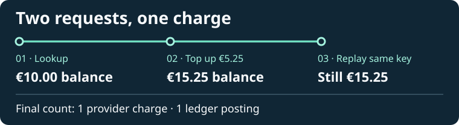
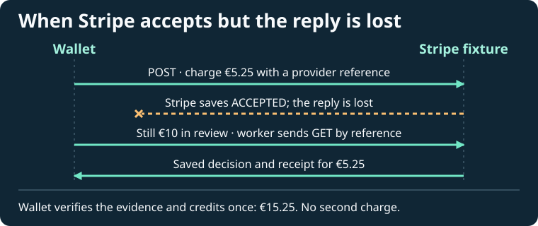
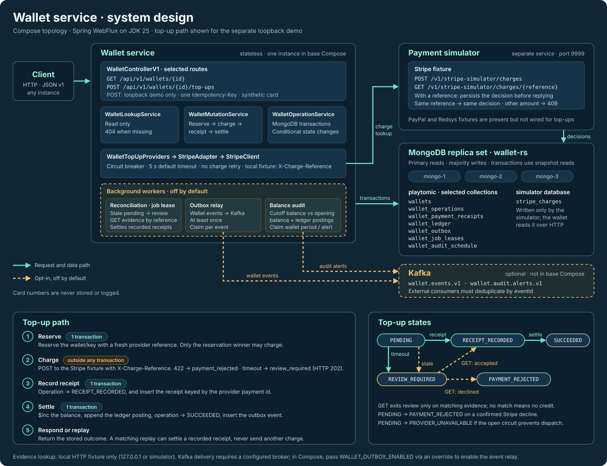

# Playtomic wallet challenge

A player can look up an existing wallet and top it up by credit card. The wallet charges a separate Stripe-compatible HTTP simulator; MongoDB stores the balance. The challenge is to handle concurrent requests and payment failures without charging or crediting twice.

## Design questions and decisions

| Question | Decision | Why it fits |
| --- | --- | --- |
| Why Java 25 rather than Java 17? | Use Java 25, the latest LTS. | It provides a newer maintenance baseline and access to language and runtime improvements. Reviewers need JDK 25 to build; security still depends on regular patching. |
| Why use reactive I/O? | Use WebFlux, WebClient and reactive MongoDB. | Requests can wait on the database or payment provider without holding a thread per wait. That suits concurrent I/O, but adds complexity and does not by itself prove higher throughput. |
| Where is extra design effort worthwhile? | Make top-up safe to replay and keep recovery, event delivery and auditing opt-in. | Durable idempotency and receipt recording address concrete payment failures. The optional workers show how to handle operational cases without being required for a normal top-up. |
| Should the submission add spending or refund endpoints? | Keep the public wallet operations focused on lookup and card top-up. | Spending and refunds are interview discussion topics. The submission goes deeper on the required flow rather than adding API contracts the exercise does not ask for. |

See the [architecture rationale and interview questions](docs/SAD.md#design-rationale).

## Quick start

Run the commands from the repository root with Docker running and the Compose plugin installed.

### Try both endpoints first

With **JDK 25, Maven 3.9+ and Python 3**, run:

```sh
python3 deployment/check-wallet.py
```

The checker builds both apps, starts a disposable MongoDB replica set, seeds a wallet, and exercises lookup and top-up with a synthetic card. A passing run exits with code `0` and removes its containers and volumes. No separate Compose startup is needed.

### Start the service and leave it running

This option only needs Docker and Compose; the images build the Java apps. The default stack supports lookup but does not expose top-up or seed a wallet on a fresh database.

1. Start the stack:

   ```sh
   docker compose -f deployment/compose.yaml up --build -d
   ```

2. Wait for readiness, then check that the wallet API responds:

   ```sh
   curl --fail --retry 12 --retry-delay 3 --retry-all-errors http://127.0.0.1:8090/actuator/health/readiness
   curl -fsS http://127.0.0.1:8090/api/v1/wallets/log
   ```

   Expect health status `UP` and a timestamp under `result.string`. To send a top-up yourself, follow the separate [interactive loopback demo](docs/wallet-reference.md#try-a-local-top-up).

3. Stop the stack when finished (database volumes are retained):

   ```sh
   docker compose -f deployment/compose.yaml down
   ```

## What the checker demonstrates





| Given | When | Expected result |
| --- | --- | --- |
| A wallet holding €10 | GET the wallet, POST €5.25, repeat with the same key, then GET again | €15.25, **one** provider charge and **one** ledger posting |
| A balance beyond JavaScript’s safe integer range | Credit one cent | The exact cent survives the HTTP round trip |
| A provider that declines | POST and replay the same key | `payment_rejected` both times, one provider call, no posting, balance still €10 |
| The local Stripe fixture accepts €5.25 but the wallet gets no receipt | Replace the simulator process, then start reconciliation | Initially `202 review_required` and €10; the worker looks up the saved reference and the wallet settles at €15.25 with one posting and no second charge. |

For process death, a MongoDB election and scheduled settlement **after the receipt is already in the wallet**, run `python3 deployment/check-wallet.py --ha`. This mode skips the simulator-replacement case.

## What is implemented?

| Operation | Availability | Contract |
| --- | --- | --- |
| `GET /api/v1/wallets/{id}` | Default and demo | Returns ID, balance and currency under `result`; missing wallet → 404. Lookup never provisions a wallet. |
| `POST /api/v1/wallets/{id}/top-ups` | Loopback demo only | Requires one `Idempotency-Key`, amount, currency, provider and the synthetic card. Only `result.status: succeeded` confirms credit. |
| `GET /api/v1/wallets/payment-providers` | Loopback demo only | Lists enabled top-up providers, not provider health. Only Stripe is wired for wallet charges. |

Spending and refunding purchases are interview discussion topics, not required HTTP routes. Spending exists internally; there is no public spend, refund or transaction-history API. The simulator demonstrates the provider boundary, not live payment processing or production authorization.

## System architecture

[](docs/system-architecture.svg)

Select the diagram to view it full size, or read the [architecture and recovery decisions](docs/SAD.md).

## Where to go next

- [Scenario runbook](docs/run-wallet.md) — start or stop the stack, exercise individual outcomes, run concurrency and fault checks, and follow operator procedures.
- [Software Architecture Document (SAD)](docs/SAD.md) — components, transaction boundaries, recovery decisions and production limits.
- [API, simulator and configuration reference](docs/wallet-reference.md) — requests, exact status mapping, provider fixtures and worker settings.
- [Balance audit](docs/wallet-balance-audit.md) · [Logging](docs/wallet-logging.md) · [Local monitoring](docs/local-monitoring.md).

For unit tests use `mvn test`. For unit **and** integration tests use `mvn verify -Dwallet.test.mongo.image=mongo:8.3.17-noble` with Docker running; Testcontainers creates its own services. Maven builds `common` (library), `wallet` (service) and `simulator` (service).
