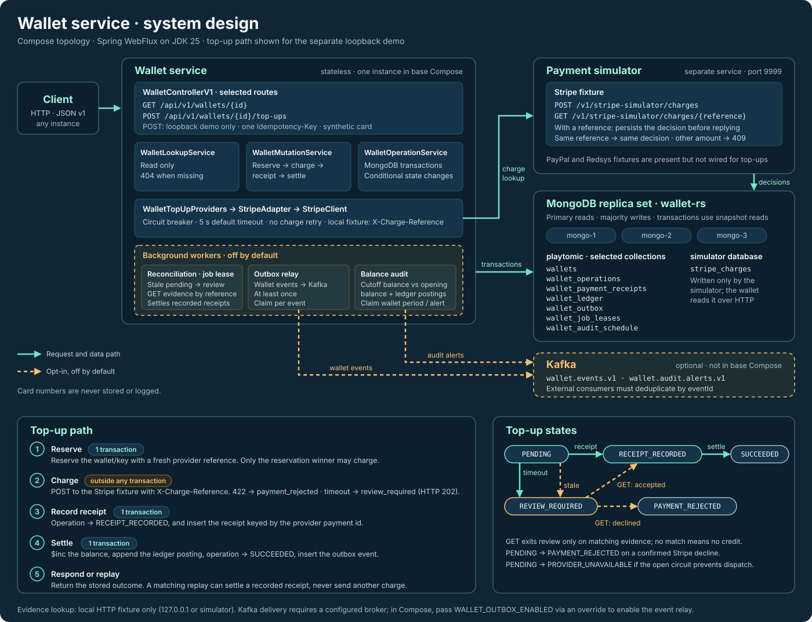

# Software Architecture Document: wallet service

**Scope:** the implemented proof of concept, not a proposed production platform. The required operations are lookup and card top-up. The design prioritizes the integrity of money over automatic completion: a delayed credit can be investigated; a second charge is not a safe way to resolve an unknown first one.

## Design rationale

- **Java 25 instead of Java 17.** This standalone exercise can target the latest LTS rather than retain Java 17 compatibility. Java 25 provides a newer maintenance baseline and access to language features finalized after 17, such as pattern matching for `switch`. A patched Java 17 distribution remains a reasonable choice where compatibility matters; choosing a newer release does not by itself establish fewer vulnerabilities.
- **Reactive I/O instead of a blocking stack.** Wallet lookup waits on MongoDB, and top-up also waits on remote HTTP. WebFlux, WebClient and reactive MongoDB let the service handle concurrent I/O without dedicating a request thread to each wait. A blocking stack, including one using virtual threads on Java 25, would offer simpler control flow and is a credible alternative. Reactive composition is a concurrency choice, not evidence of greater throughput.
- **More depth where money is at risk.** A direct charge followed by a balance update is enough to demonstrate the happy path, but it does not resolve a lost provider reply or a crash between charging and crediting. Durable reservation and receipt recording add state and writes so a replay does not dispatch another charge and a recorded receipt can settle independently. See the [runtime view](#runtime-view-a-525-top-up) for the transaction boundaries.
- **Go deeper on the required flow without expanding the API.** Lookup and card top-up are the deliverables. The opt-in reconciliation worker, Kafka relay and balance auditor make recovery, event delivery and drift detection observable without being required for a normal top-up. A smaller implementation could omit those workers; keeping them makes those scenarios testable at the cost of more code and setup. Spending and purchase refunds stay open for the interview, where their API contracts and business rules can be discussed explicitly.

### Interview questions: spending and refunds

| Question | Starting point | What to decide before exposing an endpoint |
| --- | --- | --- |
| How would a purchase debit the wallet if two requests race or one is retried? | The internal spend path already checks funds atomically. Keep that guard and define a stable purchase identity so retrying a request cannot debit twice. | Who may initiate a purchase, how the purchase ID is supplied, and what callers receive for insufficient funds or a conflicting replay. |
| How would a refund credit the wallet without returning more than was spent? | Link refunds to the original purchase and record each as a separate credit rather than rewriting the original debit. Make the refund idempotency check and cumulative refund limit part of the same local transaction. | Who may authorize a refund, whether partial refunds are allowed, and how the API responds to duplicate or concurrent refund requests. |

These are design starting points, not implemented HTTP contracts. There are no public spend, refund or transaction-history routes.

## Context and deployment

The diagram shows the Compose services and the top-up path enabled only in the separate loopback demo. Dashed arrows indicate opt-in workers; neither Kafka nor reconciliation is required for a normal credit.

MongoDB is authoritative for wallet balances and recorded operations; only the payment provider can confirm a remote charge. The `wallet` and `simulator` Maven modules produce separate executables and images. `common` is a library for shared contracts, mapping, errors and instrumentation, not a network service. Base Compose supplies three Mongo members, no broker, and a wallet port published on host loopback. The acceptance demo uses a private loopback interface for both Java processes and its client. The simulator’s PayPal and Redsys routes are independent fixtures, not fallback charge paths.

## Components and responsibilities

| Boundary | Responsibility |
| --- | --- |
| `WalletControllerV1` → lookup or mutation service | Validate HTTP input, invoke the use case, map the domain outcome to a v1 envelope and status. Lookup is read-only; it never reserves an operation or calls Stripe. |
| `WalletMutationService` → `WalletOperationService` | Coordinate idempotency, provider admission, receipt recording and local settlement. The business service chooses what must commit together. |
| `WalletTopUpProviders` → `StripeAdapter` → `StripeClient` | Dispatch one charge through the requested, explicitly registered `TopUpChargeStrategy`. Only Stripe is registered when enabled. Configuring a PayPal or Redsys client does not enable a charge strategy. There is no retry or fallback to another provider. |
| Entity services → repositories / `WalletMongoTransactions` | Map persistence entities to business models, enforce guarded mutations, and execute bounded local transactions. No JVM lock is relied on for cross-instance correctness. |
| Reconciliation, event relay and balance auditor | Opt-in background work. A lease token or claim token prevents an expired worker from committing or acknowledging work on behalf of its replacement. |

## Runtime view: a €5.25 top-up

1. **Reserve.** Validate the existing wallet and currency. Durably bind the wallet/key to the operation type, amount, currency and provider. Only the reservation winner may dispatch. A different intent under the same key conflicts; a matching replay uses the existing operation. Admission accounts for unsettled credits so that the resulting balance can still be stored exactly as Decimal128.
2. **Charge outside the wallet transaction.** The reservation stores a fresh UUIDv7 `providerReference`, distinct from the caller's idempotency key and the later receipt ID. Send the card and amount once; for the local Stripe fixture, send the reference as `X-Charge-Reference`. The simulator records its decision before replying. A confirmed 422 records rejection; a missing reply leaves the wallet uncertain. Neither side stores the card number on the operation or decision.
3. **Record the receipt.** Commit the provider payment ID and its ownership separately from crediting. This durable boundary allows another instance to finish crediting without contacting the provider.
4. **Settle locally.** In one transaction, update the balance, append the sequenced ledger posting, finalize the operation with its resulting balance and insert the outbox event. A rollback leaves no partial credit. Retry eligible transient *local* transaction failures, not an unknown commit result or any chain containing a charge.
5. **Respond or replay.** A completed replay returns the recorded result, not a newly computed current balance. A durable receipt may resume local settlement. HTTP 200 alone is not proof of credit: inspect `result.status`. See the [wire contract](wallet-reference.md#try-a-local-top-up).

## Failure decisions

| Observation | Safe action | Why |
| --- | --- | --- |
| Two instances receive the same wallet/key | Resolve the durable reservation; do not dispatch twice | Request coordination must survive process death and cannot depend on an in-memory lock. |
| Provider confirms rejection | Persist `payment_rejected`; no posting | A replay must not turn the recorded decline into a fresh payment. |
| Timeout, lost response, or abandoned pending operation with no receipt | The opt-in worker moves stale pending operations to review. For a referenced local Stripe charge it issues a GET, never another POST. | Only matching reference, currency and numeric amount authorize action: record the accepted receipt for local settlement, or close a confirmed decline without credit. A 404, mismatch or failed lookup leaves the operation in review. |
| Process dies or Mongo elects a primary after the receipt commits | Replay the original key or run reconciliation | Only local settlement remains. The worker never charges. |
| Kafka accepts an event but the relay cannot acknowledge it in Mongo | Republish after claim expiry; consumer deduplicates by `eventId` | Delivery is at least once, not exactly once. Broker availability does not define whether a credit committed. |
| Historical audit disagrees or the snapshot is unavailable | Preserve discrepancy evidence and block that wallet, or leave the cutoff due if unavailable | Never substitute today's balance for a historical snapshot or silently repair money. |

## Data and design trade-offs

In Compose both databases use the same replica set, but only the simulator accesses `simulator.stripe_charges`. The wallet reads evidence over HTTP, not across databases. A simulator restart can therefore preserve the decision if MongoDB is retained. This is a local fixture contract, not a capability assumed of the hosted sandbox.

Opaque string wallet IDs are distinct from operation IDs (derived from wallet and idempotency key) and receipt IDs (assigned by the provider). Java decimal arithmetic and BSON Decimal128 preserve exactness; v1 JSON money fields are numbers and clients must parse them as decimals. The fixture’s EUR/cents restrictions govern new Stripe charges, not every wallet balance. Internal spend checks sufficient funds as part of the database mutation. There is no public provisioning, spend, purchase-refund or history endpoint.

The extra receipt transaction costs a write but separates a fact that cannot be rolled back (provider acceptance) from a credit that can. Outbox persistence adds storage and consumer deduplication but avoids a Mongo/Kafka dual write on the request path. Per-wallet serialization and scanning unsettled credits favor correctness over hot-wallet throughput. The pressure tests establish bounded invariants, not a capacity guarantee.

## Operational and production boundary

Top-up and discovery require the loopback-only demo profile and synthetic card. There is no production owner authorization for either initial dispatch or replay. Production would need a tokenized payment-data design, TLS, provider evidence or reconciliation agreements, approved currency and amount policies, and measured capacity and recovery objectives. The auditor also requires verified opening balances and retained Mongo snapshot history. JSON logs and readiness exist; dashboards, Kafka infrastructure and pager delivery are not supplied by base Compose.

**Verification:** use the [scenario runbook](run-wallet.md) for packaged HTTP acceptance, replica-set races, crash/election recovery, Kafka delivery and audit faults. These checks have different boundaries: a test with a mocked provider cannot establish how a live payment network behaves.